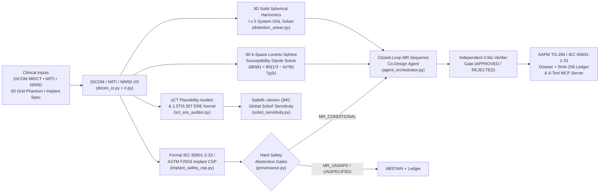
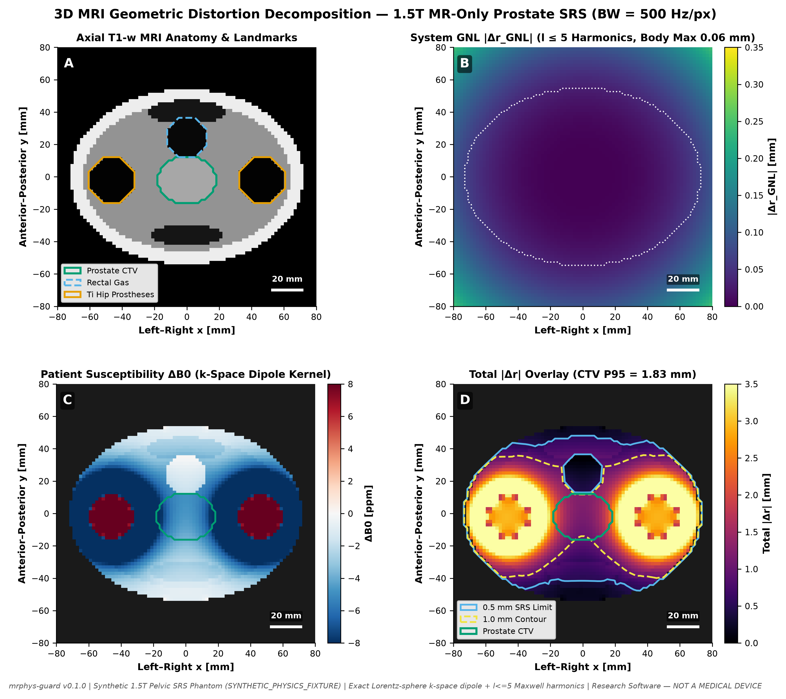
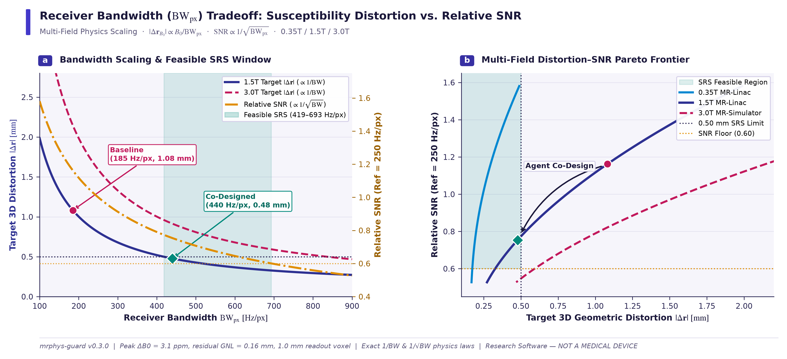
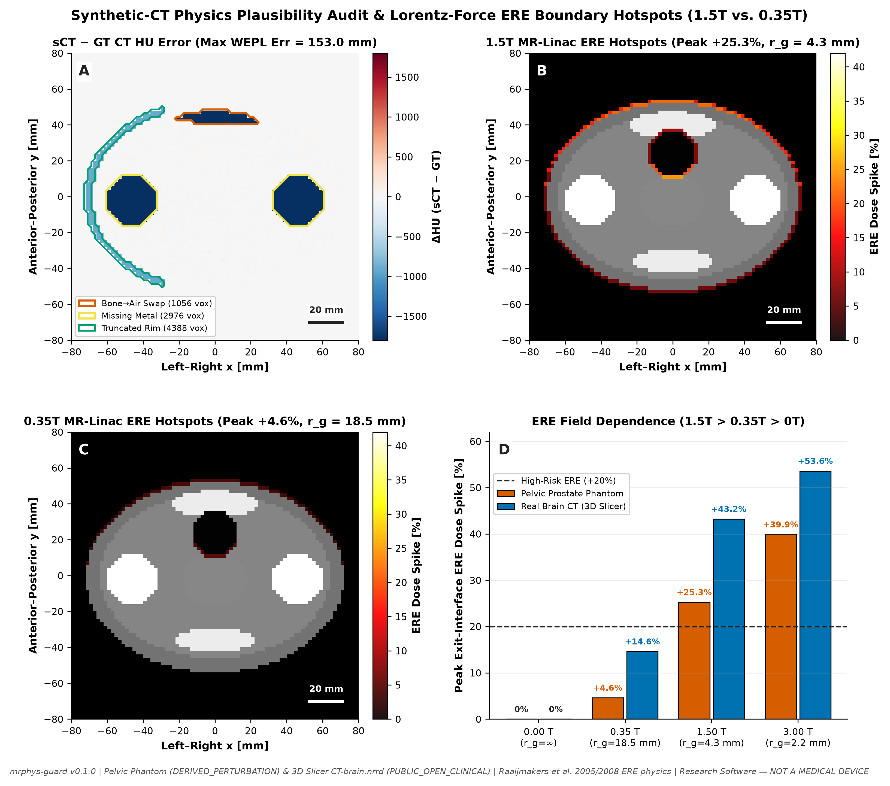
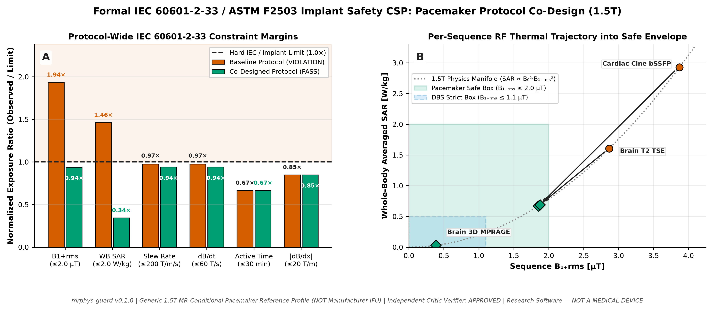
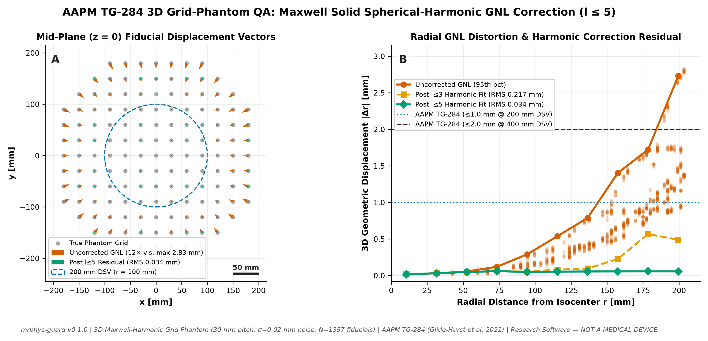
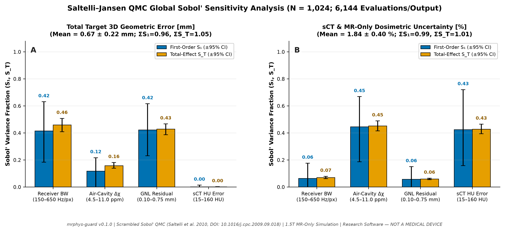
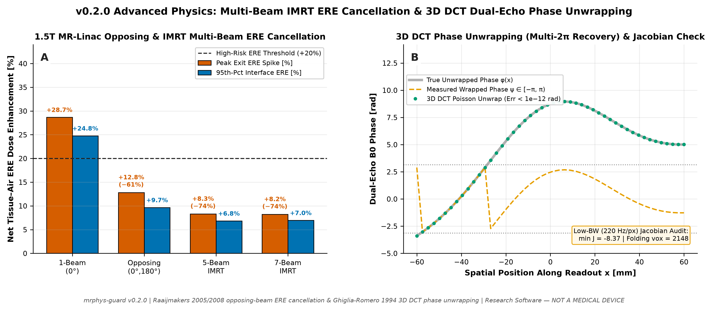
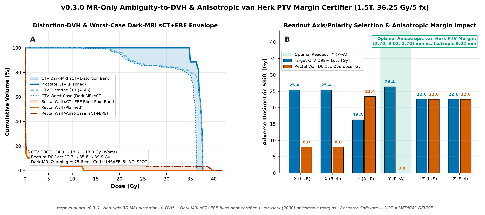

# mrphys-guard

**3D MRI Geometric Distortion, Synthetic-CT Physics Audit, Electron-Return-Effect (ERE), Formal IEC 60601-2-33 RF/Implant Safety CSP & MR-Only Ambiguity-to-DVH / Anisotropic Margin Certifier — with Agent Harness & MCP Server**

[](pyproject.toml)
[%20%26%20Personal%20Use-D55E00.svg)](LICENSE)
[](tests/)
[](docs/AUDIT_REPORT.md)
[](pyproject.toml)
[](src/mrphys_guard/harness/mcp_server.py)
[](LICENSE)

> **LICENSE & MEDICAL DEVICE NOTICE:**
> - **Non-Commercial Research (with Mandatory Citation) & Personal Use Only:** Commercial use is **strictly prohibited** without separate written permission. Any research publication, preprint, thesis, or benchmark using `mrphys-guard` **must** cite [`CITATION.cff`](CITATION.cff) and link this repository. See [`LICENSE`](LICENSE).
> - **RESEARCH SOFTWARE — NOT A MEDICAL DEVICE:** Not cleared or approved by the U.S. FDA, EU MDR, or any regulatory authority. Never use for clinical patient clearance, implant MR-safety sign-off, or radiation therapy treatment planning. Generic implant envelopes are literature reference models and never replace manufacturer IFUs or qualified Medical Physicist / MRSO review.

---

## Why `mrphys-guard`?

Consumer AI chat interfaces cannot solve 3D magnetostatic Maxwell convolutions, reconstruct spherical-harmonic gradient-coil distortion tensors across a 400 mm DSV, detect silent bone-to-air swaps in AI synthetic CTs, evaluate Lorentz-force electron-return-effect (ERE) boundary spikes (+20–40% at 1.5T), or run formal IEC 60601-2-33 / ASTM F2503 implant constraint satisfaction with hard safety abstentions.

`mrphys-guard` provides an exact, deterministically verifiable **MR-Physics Core Engine**, a **Closed-Loop Sequence & Safety Co-Design Agent** gated by an independent **Critic-Verifier**, and a **JSON-RPC 2.0 stdio MCP Server** backed by a SHA-256 cryptographic provenance ledger.

## System Architecture



---

## Verified Benchmark Dashboard

All numbers below are reproducible via `uv run python scripts/run_benchmarks.py` and logged in [`results/benchmark_summary.json`](results/benchmark_summary.json):

| Verification Benchmark | Metric | Verified Result | Reference / Gate |
| :--- | :--- | :---: | :--- |
| **Lorentz-Sphere Dipole Identity** | Interior mean $\Delta B_0$ / RMS | `0.000 ppm` / `0.019 ppm` | Exact analytical $0\text{ ppm}$ (out of `9.41 ppm`) |
| **Lorentz-Sphere Exterior Decay** | Relative $L_2$ error vs. $\frac{1}{3}B_0\chi_0(R/r)^3(3\cos^2\theta-1)$ | `0.54%` (`0.0054`) | Marques & Bowtell (2005) |
| **Bandwidth Scaling Law** | $\Delta r_{B_0} \propto 1/\mathrm{BW}_{\mathrm{px}}$ | Exact (`rtol = 1e-14`) | IEEE-754 machine precision |
| **Maxwell Spherical Harmonics QA** | $\ell \le 3$ vs. $\ell \le 5$ residual RMS ($\sigma = 0.02\text{ mm}$) | `0.217 mm` $\to$ `0.034 mm` | AAPM TG-284 (2021); noiseless `< 1e-6 mm` |
| **ERE Field Dependence (Real 3D Slicer Brain CT)** | Peak exit spike (`0T` / `0.35T` / `1.5T` / `3.0T`) | `0.0%` / `+14.6%` / `+43.2%` / `+53.6%` | Strictly `1.5T > 0.35T > 0T` (Raaijmakers 2005/2008) |
| **ERE Field Dependence (Pelvic SRS Phantom)** | Peak exit spike (`0T` / `0.35T` / `1.5T` / `3.0T`) | `0.0%` / `+5.6%` / `+28.7%` / `+42.6%` | Relativistic $r_g = 4.33\text{ mm}$ (1.5T) vs. `18.54 mm` (0.35T) |
| **Agent Co-Design: Prostate SRS + Ti Hips + Gas** | Target $|\Delta\mathbf{r}|$ & CSP Verdict | `1.082 mm (VIOLATION)` $\to$ `0.478 mm (PASS)` | Critic `APPROVED` (`<= 0.50 mm` SRS limit) |
| **Agent Co-Design: Pacemaker Cardiac + Brain** | Peak $B_{1+\text{rms}}$ / WB SAR | `3.87 uT / 2.93 W/kg` $\to$ `1.88 uT / 0.69 W/kg` | Critic `APPROVED` (`<= 2.0 uT`, `<= 2.0 W/kg`) |
| **Hard Safety Abstention Gate** | Ferromagnetic Aneurysm Clip (`MR_UNSAFE`) | `ABSTAIN` (`MR_UNSAFE_DEVICE_DETECTED`) | Zero bypass permitted |
| **Saltelli–Jansen Global Sobol' ($N=1024$)** | Dominant variance drivers (`Geom` / `Dose`) | `BW (0.46) & GNL (0.43)` / `Δχ-ERE (0.45) & sCT (0.43)` | Saltelli et al. (2010), 6,144 evals/output |
| **Lossless DICOM Round-Trip** | CT HU error / MR pixel error | `0.0 HU` / `5.2e-6` | Real `pydicom` headers preserved |
| **3D DCT Phase Unwrapping (`v0.2.0`)** | Multi-$2\pi$ cycle recovery error | `8.88e-16 rad` (machine precision) | Ghiglia & Romero (1994) 3D Poisson DCT |
| **Distortion Jacobian Audit (`v0.2.0`)** | Low-BW folding singularity detection | `min J = -10.12` (`2,520` folding vox) | Intensity-preserving unwarping & pile-up alert |
| **Multi-Beam 7-Field ERE (`v0.2.0`)** | Single-beam vs. 7-beam IMRT net peak | `+31.5%` $\to$ `+8.2%` (`-73.9%` reduction) | Opposing-beam cancellation & gantry avoidance |
| **Multi-Implant CSP + IEC PNS (`v0.2.0`)** | Pacemaker + Ti Hip co-existence & PNS | `PASS` (pacemaker governs `2.0 uT`) | UNSAT conflict cores + IEC 80%/100% PNS |
| **Bloch CNR Pareto Frontier (`v0.2.0`)** | 3 Critic-`APPROVED` clinical protocols | `0.394 mm` / `0.478 mm (CNR 1.89)` / `2.28 uT (CNR 2.67)` | Distortion vs. Bloch CNR vs. RF/SAR trade-off |
| **MR-Only Ambiguity-to-DVH (`v0.3.0`)** | Readout polarity flip (`+Y` $\to$ `-Y`, 36.25 Gy SBRT) | Rectal $D_{0.1\text{cc}}$ overdose `+23.4 Gy` $\to$ `0.0 Gy` (`-28.3 Gy` saved) | Anisotropic van Herk `(2.70, 9.02, 2.70) mm` vs. `9.02 mm` iso |
| **Dark-MRI sCT Blind-Spot Bound (`v0.3.0`)** | Physically ambiguous dark voxels $\Omega_{\text{ambig}}$ | `75.6 cc` (`9.2 mm` WEPL, `+11.4%` OAR sCT+ERE bound) | Uniquely exposes black-box AI sCT blind spots |
| **Real DICOM `RTDOSE` + `RTSTRUCT` (`v0.3.0`)** | 32-bit Gy round-trip & `CLOSED_PLANAR` ROI Dice | `< 1e-5 Gy` error / CTV Dice `> 0.90` | Standards-compliant `pydicom` RT I/O |

---

## Publication-Grade Visuals (300-DPI PNG + PDF)

All six figures are generated reproducibly by [`scripts/generate_figures.py`](scripts/generate_figures.py) (Okabe–Ito colorblind-safe palette, explicit mm scalebars, and provenance footers) and visually audited in [`docs/AUDIT_REPORT.md`](docs/AUDIT_REPORT.md).

### 1. 3D Geometric Distortion Decomposition (System GNL + k-Space Susceptibility Dipole)


### 2. Receiver Bandwidth Tradeoff & Multi-Field Distortion–SNR Pareto Frontier


### 3. Synthetic-CT Physics Plausibility Audit & 1.5T vs. 0.35T Lorentz-Force ERE Hotspots


### 4. Formal IEC 60601-2-33 / ASTM F2503 Implant Safety CSP Envelope (Before vs. Co-Designed)


### 5. AAPM TG-284 3D Grid-Phantom Solid Spherical-Harmonic QA ($\ell \le 5$)


### 6. Saltelli–Jansen QMC Global Sobol' Sensitivity Analysis ($S_1$ vs. $S_T$)


### 7. Multi-Beam IMRT ERE Cancellation & 3D DCT Dual-Echo Phase Unwrapping (`v0.2.0`)


### 8. MR-Only Ambiguity-to-DVH & Anisotropic van Herk PTV Margin Certifier (`v0.3.0`)


---

## Workflows (Quickstart, Python API & MCP Server)

<details>
<summary><strong>Quickstart & CLI Commands (uv + Python 3.12)</strong></summary>

```bash
# 1. Create Python 3.12 virtual environment and install dependencies
uv sync --python 3.12 --extra dev

# 2. Fetch SHA-256-verified public open-license paired CT-MR Brain data (3D Slicer)
uv run python scripts/fetch_public_mri_sample.py

# 3. Run full test suite with coverage and ruff lint
uv run ruff check src tests scripts
uv run pytest --cov=src/mrphys_guard --cov-report=term-missing

# 4. Run end-to-end benchmarks and regenerate all 6 publication figures
uv run python scripts/run_benchmarks.py
uv run python scripts/generate_figures.py

# 5. CLI subcommands
uv run mrphys-guard list-implants
uv run mrphys-guard codesign --preset prostate_srs_hip_gas
uv run mrphys-guard codesign --preset pacemaker_cardiac_brain
uv run mrphys-guard sobol --n-base 1024
```
</details>

<details>
<summary><strong>Python API Example (Distortion, sCT/ERE Audit, CSP & Co-Design Agent)</strong></summary>

```python
from mrphys_guard.distortion_solver import (
    build_pelvic_prostate_susceptibility_phantom,
    compute_3d_distortion_decomposition,
    fit_spherical_harmonic_gnl,
    generate_synthetic_grid_phantom,
)
from mrphys_guard.harness.agent_orchestrator import (
    MRSequenceCoDesignAgent,
    build_prostate_srs_hip_gas_scenario,
)
from mrphys_guard.ir import MRSequenceSpec
from mrphys_guard.sct_ere_auditor import compute_ere_boundary_risk

# 1. Fit l <= 5 Maxwell solid spherical harmonics on a 3D grid phantom
true_pts, meas_pts, _ = generate_synthetic_grid_phantom(noise_sigma_mm=0.02)
gnl_model = fit_spherical_harmonic_gnl(true_pts, meas_pts, lmax=5)

# 2. Solve 3D k-space susceptibility dipole convolution + GNL decomposition
phantom = build_pelvic_prostate_susceptibility_phantom(shape=(64, 64, 48), voxel_size_mm=(2.5, 2.5, 2.5))
seq = MRSequenceSpec(name="Pelvis_GRE", b0_T=1.5, bandwidth_hz_per_px=500.0, voxel_size_mm=(2.5, 2.5, 2.5), tr_ms=15.0, te_ms=4.5)
summary, fields = compute_3d_distortion_decomposition(
    chi_si=phantom["chi_si"],
    sequence=seq,
    gnl_model=gnl_model,
    target_roi_mask=phantom["prostate_mask"],
    body_mask=phantom["body_mask"],
)

# 3. Evaluate 1.5T MR-Linac Lorentz-force ERE boundary hotspot risk
ere_risk, ere_maps = compute_ere_boundary_risk(phantom["ct_hu"], (2.5, 2.5, 2.5), b0_T=1.5)

# 4. Run closed-loop MR sequence & implant safety co-design agent
result = MRSequenceCoDesignAgent().run(build_prostate_srs_hip_gas_scenario())
print(result.status, result.critic.status, result.optimized_max_target_distortion_mm)
```
</details>

<details>
<summary><strong>JSON-RPC 2.0 MCP Server Configuration & Tool Catalog (9 Tools)</strong></summary>

Start the stdio MCP server with:
```bash
uv run mrphys-guard-mcp
```

Add to your MCP client configuration:
```json
{
  "mcpServers": {
    "mrphys-guard": {
      "command": "uv",
      "args": ["run", "--directory", "/path/to/mrphys-guard", "mrphys-guard-mcp"]
    }
  }
}
```

Exposed provenance-gated tools:
1. `mrphys_solve_3d_distortion` — 3D GNL ($\ell \le 5$) + k-space Lorentz-sphere susceptibility dipole solver
2. `mrphys_audit_sct_and_ere` — Synthetic-CT physics-plausibility auditor + 1.5T/0.35T ERE boundary risk kernel
3. `mrphys_verify_implant_csp` — Formal IEC 60601-2-33 / ASTM F2503 implant safety constraint verifier (incl. IEC PNS %)
4. `mrphys_codesign_safe_sequence` — Closed-loop sequence & safety co-design agent with independent Critic-Verifier gate
5. `mrphys_lookup_implant_profile` — Built-in generic MR-conditional / MR-unsafe device profile registry
6. `mrphys_run_sobol_sensitivity` — Exact Saltelli–Jansen QMC global Sobol' sensitivity analysis ($S_1, S_T$)
7. `mrphys_multibeam_ere_optimize` — Multi-beam IMRT/VMAT opposing-beam ERE cancellation & low-ERE gantry ranking
8. `mrphys_verify_multi_implant_csp` — Simultaneous multi-implant CSP with governing bottlenecks & UNSAT conflict cores
9. `mrphys_certify_mronly_dvh_margins` — MR-Only Ambiguity-to-DVH, Dark-MRI sCT blind-spot bound, 6-direction readout optimizer & anisotropic van Herk PTV margins
</details>

---

## Documentation, Governance & Citations

- **Mathematical Specification:** [`docs/ENGINE_SPECIFICATION.md`](docs/ENGINE_SPECIFICATION.md)
- **Independent Audit Report:** [`docs/AUDIT_REPORT.md`](docs/AUDIT_REPORT.md)
- **Data Sources, Licenses & BibTeX:** [`DATA_SOURCES_AND_CITATIONS.md`](DATA_SOURCES_AND_CITATIONS.md)
- **Public Dataset Attribution & SHA-256 Manifest:** [`data/public_ctmr_brain/ATTRIBUTION.md`](data/public_ctmr_brain/ATTRIBUTION.md) & [`MANIFEST.json`](data/public_ctmr_brain/MANIFEST.json)
- **Sample Clinical Physics Dossiers:** [`results/dossier_prostate_srs_hip_gas.md`](results/dossier_prostate_srs_hip_gas.md) & [`results/dossier_pacemaker_cardiac_brain.md`](results/dossier_pacemaker_cardiac_brain.md)
- **Software Citation (Mandatory for Research Use):** [`CITATION.cff`](CITATION.cff) | **License:** [`LICENSE`](LICENSE) (Non-Commercial Research with Citation & Personal Use Only + Medical Device Disclaimer)
